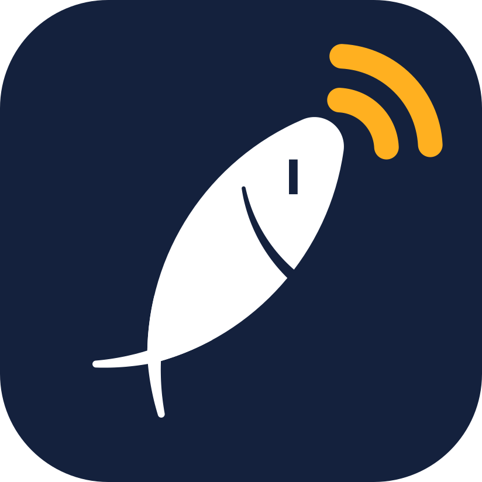
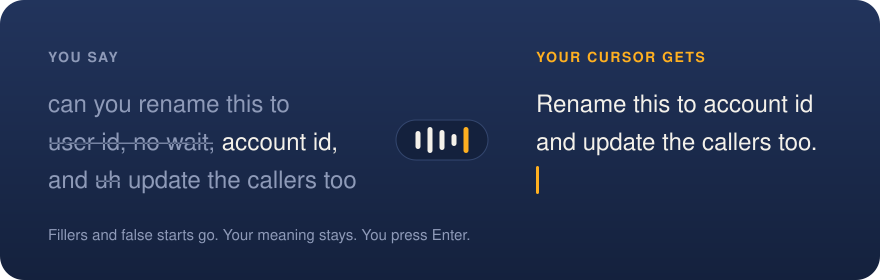
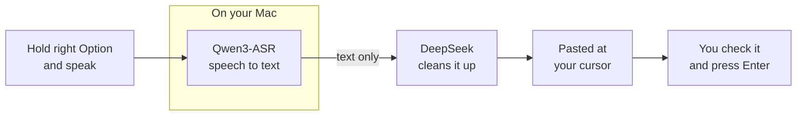

<p align="center">
  
</p>

<h1 align="center">Quoth</h1>

<p align="center">
  <strong>Say it messy. Send it clean.</strong><br>
  Hold a key, speak Chinese or English, and a clean prompt lands at your cursor.
</p>

<p align="center">
  
  
  
</p>

<p align="center">
  
</p>

Chinese and English both work, and long requests keep their constraints:

| You say | Your cursor gets |
|---|---|
| okay so three things, first fix the login page, second add the missing test, and then third update the readme I guess | Fix the login page, add the missing test, and update the readme. |
| 呃我现在这个项目啊它那个接口特别慢，就是用户一打开页面要等好几秒，我感觉可能是数据库的问题，也可能不是，你先帮我看一下，先别改代码，就是看完告诉我原因，然后我们再决定怎么改，对，先别改 | 我现在这个项目接口特别慢，用户一打开页面要等好几秒。我感觉可能是数据库的问题，也可能不是。你先帮我看一下，先别改代码，看完告诉我原因，然后我们再决定怎么改。对，先别改。 |

<sub>Real output from the rewrite step, using inputs from <a href="evals/rewrite_cases.tsv">the test cases</a>.</sub>

## How it works



- **Your meaning stays intact.** Fillers and false starts go, and self-corrections keep only the final version. The rewrite is told to keep every request and constraint, and to add nothing.
- **Audio stays on your Mac.** Speech recognition runs locally. Only the transcript goes to DeepSeek.
- **Nothing sends itself.** A misheard word should not become an instruction, so you press Enter.
- **You keep what you said.** If the rewrite fails or takes over 5 seconds, you get the raw transcript.

## Performance

Measured on an M5 with 16 GB, using 20 read-aloud clips (10 Chinese, 10 English, 3.6 to 30 seconds) from one speaker.

| Chinese CER | English WER | Recording to clean text, median | Slowest clip | Memory |
|---|---|---|---|---|
| 1.6% | 5.0% | 1.25 s | 1.57 s | 1.34 GB |

Times cover speech recognition and the rewrite, measured from a saved recording, so they leave out pasting. The sample is small. See [docs/design.md](docs/design.md) for the model comparison.

## Quick start

You need an Apple Silicon Mac, Python 3.12, the Xcode Command Line Tools and a DeepSeek API key.

```bash
python3.12 -m venv .venv
.venv/bin/pip install -e ".[dev,bench]"
cp .env.example .env   # then add your DeepSeek key
macos/build.sh
open /Applications/Quoth.app
```

This builds a small native launcher and installs `Quoth.app`, which you can then open from Spotlight. To start it at login, add it under System Settings > General > Login Items. If the checkout is in Documents, allow that access when asked. A setup window then shows what is left to turn on, and you can reopen it from the menu bar.

The first launch downloads the speech model, so the menu bar waveform stays dim until that finishes.

When the menu bar waveform turns solid, click into any text box, hold the right Option key, speak, and let go. A small pill at the bottom of the screen shows that it is listening. Press Enter yourself to send. Errors go to `~/Library/Logs/Quoth.log`.

## Good to know

- The app runs Python from this checkout, so code changes only need a restart. Moving the checkout or changing anything in `macos/` may mean granting the permissions again.
- The microphone stays open while the app runs, so macOS shows its recording indicator the whole time. Audio is only kept while the key is held.
- Restart the app after changing the input device.
- To run without the app, use `.venv/bin/quoth-app` from Terminal.app and grant the same permissions to Terminal.

## Clean up a recording

```bash
.venv/bin/quoth recording.wav
```

The prompt goes to stdout and timings go to stderr. Input must be 16 kHz mono WAV.

## Benchmarks

```bash
.venv/bin/python evals/record_samples.py        # read 20 scripts aloud
.venv/bin/python evals/bench_asr.py --backend qwen
.venv/bin/python evals/bench_asr.py --backend whisper
.venv/bin/python evals/bench_rewrite.py         # calls the DeepSeek API
```

Run the recorder from Terminal.app: macOS may give apps without microphone access silent audio. Recordings and results stay in `evals/samples/` and `evals/results/`, which git ignores.

## License

[MIT](LICENSE)
