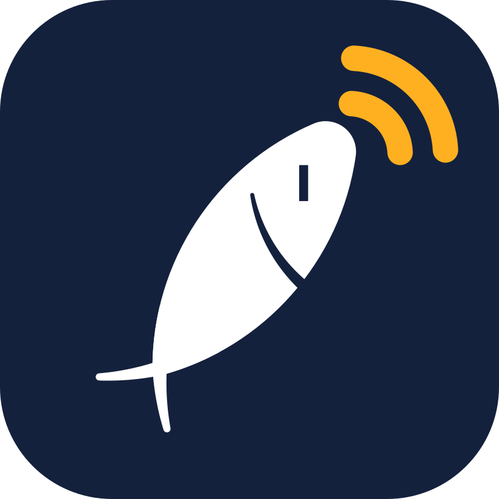
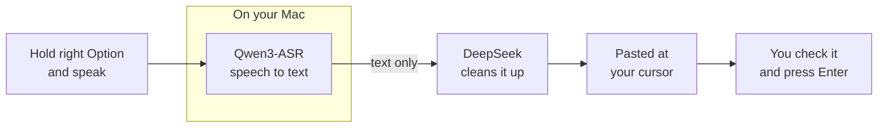

<p align="center">
  
</p>

<h1 align="center">Archerfish</h1>

<p align="center">
  <strong>Say it messy. Send it clean.</strong><br>
  Hold a key and think out loud. A clear prompt lands at your cursor, ready for your AI assistant.
</p>

<p align="center">
  
  
  
</p>

<p align="center">
  
</p>

<p align="center"><sub>Real output from the rewrite step. The input is the <code>en-ramble</code> case in <a href="evals/rewrite_cases.tsv">the test cases</a>.</sub></p>

Talking is faster than typing, but a raw transcript of how people talk makes a poor prompt. Archerfish keeps what you asked for and drops the rest:

- **Changed your mind halfway?** Only the final version stays.
- **Constraints buried in the rambling?** Every one of them comes through, and nothing is added.
- **Chinese, English, or both in one sentence?** Speak however you think; technical terms stay as you said them.
- **About 1.3 seconds** from letting go of the key to clean text.
- **Audio never leaves your Mac.** Speech recognition runs locally; only the text goes to DeepSeek.
- **Nothing sends itself.** You read it, then press Enter. If the cleanup fails, you get your raw words, never nothing.

## Quick start

You need an Apple Silicon Mac, Python 3.12, the Xcode Command Line Tools and a DeepSeek API key.

```bash
python3.12 -m venv .venv
.venv/bin/pip install -e ".[dev,bench]"
cp .env.example .env   # then add your DeepSeek key
macos/build.sh
open /Applications/Archerfish.app
```

A setup window shows which permissions are left to turn on. The first launch downloads the speech model; when the menu bar waveform turns solid, click into any text box, **hold the right Option key, speak, and let go**.

## How it works



The cleanup prompt is in [`src/archerfish/prompts/rewrite.md`](src/archerfish/prompts/rewrite.md). It removes fillers, false starts and repetition, keeps every request and constraint, adds nothing, and never answers or carries out what you said. If the API fails or takes over 5 seconds, the raw transcript is pasted instead.

## Performance

Measured on an M5 with 16 GB, using 20 read-aloud clips (10 Chinese, 10 English, 3.6 to 30 seconds) from one speaker.

| Chinese CER | English WER | Recording to clean text, median | Slowest clip | Memory |
|---|---|---|---|---|
| 1.6% | 5.0% | 1.25 s | 1.57 s | 1.34 GB |

Times cover speech recognition and the rewrite, measured from a saved recording, so they leave out pasting. The sample is small. See [docs/design.md](docs/design.md) for the model comparison.

## Why "Archerfish"

An archerfish hunts from below the water. It spots an insect on a leaf above the surface and knocks it down with one precise jet of water from its mouth, even correcting for the way water bends light. Archerfish does the same with your voice: you say it however it comes out, and one clean, well-aimed prompt lands at your cursor. Its sibling [Earfish](https://github.com/yx-yan/earfish) listens for you; this one speaks for you. The fish in the logo is the 盐鱼鲜 (Yan Yu Xian) fish from its author's personal brand.

## Good to know

- Archerfish holds about 1 GB of memory while it runs, mostly the speech model, so it can start the moment you press the key. On an 8 GB Mac that is a real share.
- To start it at login, add it under System Settings > General > Login Items. If the checkout is in Documents, allow that access when asked.
- The app runs Python from this checkout, so code changes only need a restart. Moving the checkout or changing anything in `macos/` may mean granting the permissions again.
- The microphone stays open while the app runs, so macOS shows its recording indicator the whole time. Audio is only kept while the key is held.
- Restart the app after changing the input device.
- Errors go to `~/Library/Logs/Archerfish.log`.
- To run without the app, use `.venv/bin/archerfish-app` from Terminal.app and grant the same permissions to Terminal.

<details>
<summary><strong>Clean up a recording from the command line</strong></summary>

```bash
.venv/bin/archerfish recording.wav
```

The prompt goes to stdout and timings go to stderr. Input must be 16 kHz mono WAV.

</details>

<details>
<summary><strong>Run the benchmarks</strong></summary>

```bash
.venv/bin/python evals/record_samples.py        # read 20 scripts aloud
.venv/bin/python evals/bench_asr.py --backend qwen
.venv/bin/python evals/bench_asr.py --backend whisper
.venv/bin/python evals/bench_rewrite.py         # calls the DeepSeek API
```

Run the recorder from Terminal.app: macOS may give apps without microphone access silent audio. Recordings and results stay in `evals/samples/` and `evals/results/`, which git ignores.

</details>

## License

[MIT](LICENSE)
